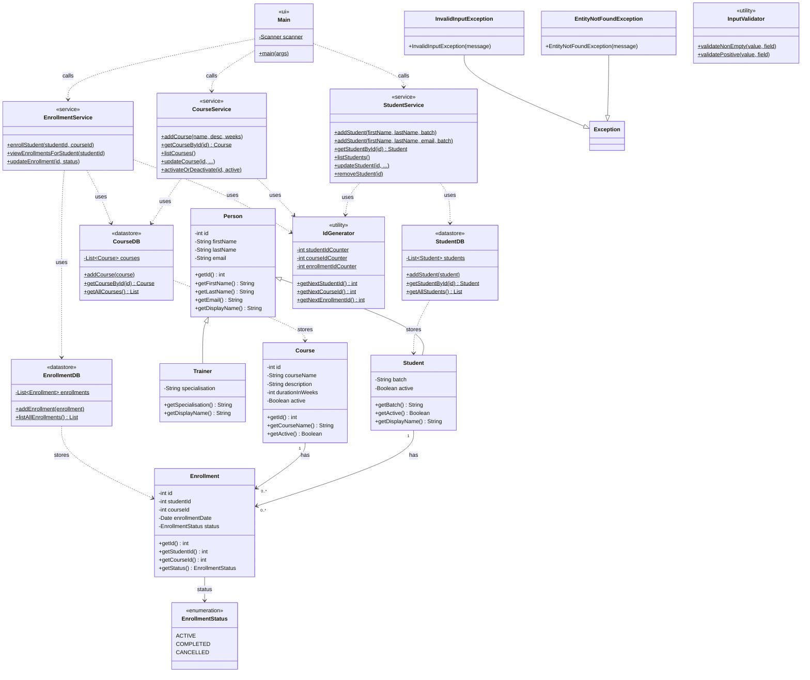

# LearnTrack — Student Course Management System

A menu-driven console application built in Java that manages students, courses,
and enrollments. All data is held in memory using `ArrayList` — no database or
file I/O required.

---

## Project Structure

```
src/com/airtribe/learntrack/
├── ui/          Main.java              — console menu & user input
├── entity/      Student, Course, Enrollment, Person, Trainer,
│                EnrollmentStatus       — domain model
├── service/     StudentService, CourseService, EnrollmentService
│                                       — business logic
├── db/          StudentDB, CourseDB, EnrollmentDB
│                                       — in-memory data store
├── exception/   EntityNotFoundException, InvalidInputException
├── util/        IdGenerator, InputValidator
docs/
├── Setup_Instructions.md
├── JVM_Basics.md
└── Design_Notes.md
```

---

## Class Diagram



---

## Prerequisites

| Tool | Minimum version |
|------|----------------|
| JDK  | 17 (uses switch-expression arrow syntax) |

Verify your installation:

```bash
java -version
javac -version
```

---

## Compile

From the project root (the directory that contains `src/`):

```bash
# Create the output directory
mkdir -p out

# Compile all source files
javac -d out $(find src -name "*.java")
```

---

## Run

```bash
java -cp out com.airtribe.learntrack.ui.Main
```

You will see a menu like:

```
========================================
   Welcome to LearnTrack
========================================
----------------------------------------
  Main Menu
----------------------------------------
  1. Student Management
  2. Course Management
  3. Enrollment Management
  0. Exit
----------------------------------------
Enter choice:
```

---

## Features

### Student Management
- Add a student (with or without an email address)
- List all students
- Search a student by ID
- Update student details (any field, others are preserved)
- Deactivate a student (soft-delete — sets `active = false`)

### Course Management
- Add a course
- List all courses
- Activate or deactivate a course

### Enrollment Management
- Enroll a student in a course
- View all enrollments for a student
- Mark an enrollment as **Completed** or **Cancelled**

---

## Error Handling

- Typing a non-number at any numeric prompt re-prompts cleanly.
- Entering an unknown menu option shows `[!] Invalid option.`
- Referencing a student, course, or enrollment that does not exist prints
  the error message from `EntityNotFoundException` — no stack trace is shown.

---

## Package

`com.airtribe.learntrack`
